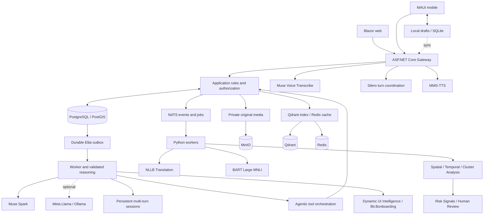

# SwiftAid | AI-Powered Community Disease Surveillance and Early Outbreak Intelligence

**Give underserved communities an earlier voice in public health surveillance.**

SwiftAid is an offline-first, AI-powered community health platform being built to help underserved communities in **Zimbabwe and Eswatini** report concerns earlier and connect frontline health workers with actionable public health intelligence. Its vision is to turn fragmented community reports into explainable early-warning signals that authorized health officials can investigate.

[GitHub](https://github.com/Vuminkosi/Swift-Aid) · [Run locally](#run-locally) · [Local open-weight reasoning](#local-open-weight-reasoning) · [Architecture](#architecture) · [Licensing](#licensing)

> **Status: functional prototype under active development.** Reporting, case workflows and Ellai have implemented paths and bounded test evidence. Multilingual quality, continuous voice reliability and end-to-end surveillance validation are not complete. This README distinguishes the vision from current capabilities; it is not a claim of production or clinical readiness.

## Why SwiftAid exists

Limited connectivity, language barriers, fragmented reporting and delayed access to expertise make community surveillance difficult. A concerning pattern can develop across several villages while each report remains isolated. Reports that could warrant a cholera investigation, for example, may arrive at different times and through different people; a report alone does not establish its cause.

SwiftAid aims to connect observations without losing provenance or uncertainty. Health workers should be able to record what they observed, preserve original evidence, identify missing details, and get information to the people authorized to act.

The vision combines multilingual reporting, geospatial and temporal analysis, and constrained AI workflows to investigate relationships between reports. Explainable summaries should show the observations behind a possible signal, missing or conflicting information, uncertainty, and recommended verification steps. A possible pattern is **not a confirmed outbreak**. SwiftAid supports medical and public health professionals; it does not replace them or autonomously diagnose disease.

## Who it serves

| Audience | Intended value |
| --- | --- |
| Community members | Share human or animal health concerns through account-free, private intake. |
| Community health workers | Capture observations, retain work through connectivity gaps and follow up with clearer context. |
| Authorized health and veterinary teams | Review assigned cases, coordinate work, preserve evidence and track accountable follow-through. |
| Public health officials | Ultimately review evidence-backed cross-community signals with explicit uncertainty and human verification. |

Zimbabwe and Eswatini are the initial focus. Public reporting accepts country information without promising organizational coverage everywhere. A report does not grant staff access, guarantee assignment or initiate emergency dispatch.

## The experience we are building

1. **Capture a concern:** guided reporting, natural language or voice; unknown facts remain unknown.
2. **Keep working offline:** preserve drafts and queued work. Local saving is distinct from server acceptance.
3. **Clarify the record:** AI-assisted intake aims to extract factual observations and ask context-aware questions about missing details without inventing symptoms or diagnoses.
4. **Synchronize securely:** reconcile accepted work, permissions, versions and receipts when connectivity returns.
5. **Connect the evidence:** investigate unusual patterns across places and time rather than treating reports independently.
6. **Verify with people:** authorized officials review possible signals and decide the response. Approval-controlled actions remain explicit and auditable.

Offline access to downloaded, source-linked materials is part of the design. This means approved reference content, not AI-generated medical advice. AI analysis runs when the configured inference service is reachable; offline reporting does not imply that every model runs on a phone.

## Current capabilities and boundaries

| Area | Current position |
| --- | --- |
| Intake and casework | Implemented reporting, review, ownership, immutable history and operational workflows. Server-side authorization separates public intake from staff commands. |
| Offline work | Local drafts and native offline/synchronization components exist. Device restart, revocation and reconnect acceptance must be evaluated per workflow. |
| Ellai text | Durable user/assistant outcomes, PostgreSQL outbox processing, owner-authorized history and streaming delivery. Real browser conversations have completed and restored. |
| Tool progress | Gateway-managed acknowledgement, existing MMS-TTS playback and final-answer priority; browser and Android emulator evidence recorded. |
| Continuous voice | Persistent-session architecture, Muse transcription and Silero turn coordination implemented. Full five-turn acceptance, natural interruption and physical-device acoustics remain incomplete. |
| Languages | English is the current voice baseline. Shona and siSwati are target experiences requiring quality evaluation and validated translations. |
| Outbreak intelligence | Prototype objective and gated extension. Cross-sector health-pattern inference remains off by default pending product approval and applicable validation. |
| Clinical functions | No AI diagnosis, symptom-derived clinical triage, treatment advice, veterinary advice or AI-authored health education. |

Latest Ellai evidence includes tool-response journeys of roughly **35–70 seconds** and a voice run that did not complete all five replies. These are outstanding issues, not accepted service levels. See [Ellai implementation and validation](docs/ellai-voice-processing-progress.md).

## Import cases from Workspace

Authorized staff can open **Workspace → Imports**, select an organization, workspace and country, and upload the supported CSV. Multiple organizations can participate in one workspace; membership, grants and case visibility remain organization-scoped. A workspace link alone grants no access.

Imports use bounded batches and the normal case-registration rules. The page shows durable row counts and rejection details. Pause after a batch, refresh and resume with the unchanged original file; stable command IDs prevent duplicate cases when an accepted row is retried. Import completion means the file was processed and may include rejected rows. It does not mean surveillance analysis is complete.

See the [CSV format and examples](docs/architecture/gateway-import-format.md), [migration and runtime-grant runbook](docs/architecture/gateway-operational-runbook.md), and [measured verification report](docs/architecture/gateway-performance-report.md). The supplied 15,000 synthetic reports passed durable HTTP/PostgreSQL ingestion and replay checks; larger-scale processing and downstream intelligence remain outstanding.

Ellai can help describe the import schema, validate observation formatting and inspect the current staff member's authorized import progress. These tools preserve the normal submission and approval boundaries.

## Meta models and their roles

| Model / route | Use in SwiftAid | Boundary |
| --- | --- | --- |
| **Muse Spark** | Hosted Ellai reasoning: understand requests, select authorized read tools, use context and produce responses. | Validated output cannot grant access or bypass approval receipts. Account-specific endpoints/model IDs are configured privately. |
| **Muse Voice Transcribe** | Convert live or uploaded speech into text; Gateway-confirmed turns enter durable processing. | A provisional endpoint is not a completed conversation. Languages need individual quality evaluation. |
| **Meta MMS-TTS** | Speak responses and brief tool-progress acknowledgements through Gateway audio delivery. | Current checkpoint `facebook/mms-tts-eng`: English, noncommercial use, opt-in deployment. |
| **Meta Llama via Ollama** | Optional local open-weight text reasoning through the existing provider abstraction. | `llama3.2:3b` is a development starting point, not a claim of Muse-equivalent quality. It does not replace ASR or TTS. |

Silero ONNX detects acoustic activity at Gateway; it is a separate component, **not a Meta model**. Microsoft Agent Framework integration and application orchestration connect reasoning to existing contracts. Authorization, persistence and approval remain application responsibilities. Generic browser/device TTS is not substituted for MMS-TTS. English acknowledgements remain the fallback until siSwati and Shona translations are reviewed.

## Architecture



## Detailed architecture — how all components connect

```
SWIFTAID PLATFORM
│
├── 1. CLIENT / PRESENTATION LAYER
│   │
│   ├── Offline-First Web Application (PWA)
│   │   ├── Authentication / Registration
│   │   ├── Dashboard / Intelligence Overview
│   │   ├── Case Reporting / Case Detail
│   │   ├── Community Sessions
│   │   ├── Surveillance / Geographic Maps
│   │   ├── Outbreak Alerts / Investigations
│   │   └── Administration
│   │
│   ├── Offline Data Layer
│   │   ├── IndexedDB / Local Case Queue
│   │   ├── Cached Reference Data
│   │   ├── Offline Attachments
│   │   └── Background / Reconnection Sync
│   │
│   ├── ELLAI USER INTERFACE
│   │   ├── Chat Interface
│   │   ├── Persistent Conversation Display
│   │   ├── Living Activator / Thinking States
│   │   └── Context-Aware Assistant Actions
│   │
│   ├── MUSE LIVE SPEAK
│   │   ├── Microphone Capture
│   │   ├── Speech Recognition
│   │   ├── Voice Activity / Turn Detection
│   │   ├── Interruption / Barge-In
│   │   └── Speech Playback
│   │
│   └── BIT.BONBOARDING
│       ├── UI Element Highlighting
│       ├── Popovers / Guided Actions
│       ├── Cross-Page Navigation
│       └── Completion Verification
│
│                     │ HTTPS / Streaming
│                     ▼
│
├── 2. API GATEWAY / APPLICATION ENTRY
│   │
│   ├── Identity / Authorization
│   │   ├── Native Authentication
│   │   ├── Google / Facebook Federation
│   │   ├── Role-Based Access Control
│   │   └── Country / Organization Scope
│   │
│   ├── REST / Application APIs
│   ├── Realtime / Streaming Endpoints
│   ├── Offline Synchronization
│   ├── Durable Job Admission
│   ├── Request Validation / Rate Limiting
│   └── Transactional Outbox
│
│                     │
│           ┌─────────┴──────────┐
│           ▼                    ▼
│
├── 3. BUSINESS DOMAIN       4. ELLAI AI CORE
│   │                        │
│   ├── Case Management      ├── Conversation Manager
│   │   ├── Reports          │   ├── Persistent Sessions
│   │   ├── Evidence         │   ├── Multi-Turn Context
│   │   ├── Locations        │   ├── Memory / Retrieval
│   │   └── Case History     │   └── Turn Lifecycle
│   │                        │
│   ├── Community Sessions   ├── Reasoning Orchestrator
│   ├── User Management      │   ├── LLM Inference
│   ├── Organization Mgmt    │   ├── Tool Calling
│   ├── Investigation Mgmt   │   ├── Validation / Retry
│   ├── Alert Management     │   └── Workflow Execution
│   └── Notifications        │
│                            ├── Dynamic UI Intelligence
│                            │   ├── UI Registry
│                            │   ├── UI Discovery
│                            │   ├── Guidance Planner
│                            │   ├── Tour Compiler
│                            │   └── Session Coordinator
│                            │
│                            └── Multilingual Voice Lane
│                                ├── Muse STT
│                                ├── NLLB Translation
│                                ├── MMS-TTS / Local TTS
│                                └── Response Streaming
│
│           │                    │
│           └──────────┬─────────┘
│                      ▼
│
├── 5. DURABLE PROCESSING / EVENT BACKBONE
│   │
│   ├── Database Transaction + Outbox
│   │              │
│   │              ▼
│   ├── Outbox Publisher
│   │              │
│   │              ▼
│   ├── NATS JetStream
│   │   ├── Case Submitted / Updated
│   │   ├── Translation Requested / Completed
│   │   ├── Classification Requested / Completed
│   │   ├── Surveillance Analysis Requested
│   │   ├── Risk Signal Created
│   │   ├── Alert Created / Updated
│   │   └── Investigation Events
│   │
│   └── Durable Consumers / Worker Services
│       ├── Translation Worker (NLLB)
│       ├── Classification Worker (BART MNLI)
│       ├── Case Enrichment Worker
│       ├── Geospatial Intelligence Worker
│       ├── Temporal Analysis Worker
│       ├── Cluster Detection Worker
│       └── Notification Worker
│                      │
│                      ▼
│
├── 6. SURVEILLANCE INTELLIGENCE
│   │
│   ├── Case Normalization / Feature Extraction
│   ├── Persisted Translation / Classification
│   ├── Geographic + Temporal Aggregation
│   ├── Symptom / Syndrome Pattern Detection
│   ├── Potential Cluster Detection
│   ├── Baseline / Anomaly Detection
│   ├── Risk Assessment / Signal Generation
│   ├── Explainable Evidence / Provenance
│   └── Human Review / Investigation
│                      │
│                      ▼
│
├── 7. INTELLIGENCE CONSUMPTION
│   │
│   ├── Surveillance Dashboard
│   ├── Maps / Hotspots / Geographic Layers
│   ├── Disease / Syndrome Trends
│   ├── Cluster Detail / Supporting Cases
│   ├── Investigation Workspaces
│   ├── Alert Queues / Notifications
│   └── Ellai Natural-Language Queries
│
└── 8. SHARED INFRASTRUCTURE
    │
    ├── PostgreSQL
    │   ├── Operational Data
    │   ├── Conversations / Messages
    │   ├── Outbox / Job State
    │   ├── Model-Versioned Results
    │   └── Audit / Evidence References
    │
    ├── PostGIS (Spatial Queries)
    │
    ├── MinIO (S3-Compatible)
    │   ├── Audio / Images / Attachments
    │   ├── Original Evidence
    │   └── Generated Artifacts
    │
    ├── NATS JetStream (Event Durability)
    │
    ├── AI Inference Runtime
    │   ├── LLM
    │   ├── NLLB
    │   ├── BART Large MNLI
    │   └── Speech Models
    │
    └── Monitoring / Logging / Tracing
```

- **PostgreSQL/PostGIS is authoritative** for records, permissions, messages, outcomes and provenance. Ellai uses a PostgreSQL outbox, not a JetStream replacement.
- **Gateway owns the trust boundary.** Clients receive no provider, database or object-store credentials. Public intake is separate from privileged commands.
- **Qdrant and Redis are derived services.** Neither replaces current authorization or case truth. Semantic retrieval requires a verified encoder.
- **Voice has separate lifetimes:** microphone session, speech turn, transcription request and assistant response. A turn should not require reopening permissions.
- **Delivery has explicit outcomes.** Provisional chunks reconcile against the validated durable result. Ephemeral progress stays out of canonical history.
- **Effects remain controlled.** Approval receipts, idempotency and current-scope checks govern actions; spoken agreement is not authorization.

### Repository map

| Path | Purpose |
| --- | --- |
| [`src/SwiftAid.Gateway`](src/SwiftAid.Gateway) | HTTP endpoints, identity, web host, Ellai worker and voice transport. |
| [`src/SwiftAid.Browser`](src/SwiftAid.Browser), [`src/SwiftAid.UI`](src/SwiftAid.UI) | Browser host and shared MudBlazor components. |
| [`src/SwiftAid.Mobile`](src/SwiftAid.Mobile), [`src/SwiftAid.Client`](src/SwiftAid.Client) | Native host, device services and offline/client infrastructure. |
| [`src/SwiftAid.Domain`](src/SwiftAid.Domain), [`src/SwiftAid.Application`](src/SwiftAid.Application) | Invariants, use cases and orchestration. |
| [`src/SwiftAid.Infrastructure`](src/SwiftAid.Infrastructure) | Persistence, migrations and service adapters. |
| [`src/SwiftAid.Intelligence`](src/SwiftAid.Intelligence) | Meta, Ollama and speech adapters. |
| [`src/SwiftAid.Contracts`](src/SwiftAid.Contracts), [`src/SwiftAid.GuestIntake`](src/SwiftAid.GuestIntake) | Contracts and public-intake client boundary. |
| [`workers`](workers), [`infra`](infra) | Python workers, Compose and optional speech service. |
| [`tests`](tests), [`resources/demodata`](resources/demodata) | Automated checks and synthetic examples. |

## Run locally

Use a **disposable local development environment**, PowerShell from the repository root, and Docker Linux containers. Compose uses development HTTP/cookies; it is not a production deployment manifest.

### 1. Prerequisites and checkout

- Git and Docker Compose v2 supporting optional `env_file` entries.
- .NET SDK **10.0.403**, or a compatible patch selected by [`global.json`](global.json).
- EF tooling **10.0.14**, matching the repository's EF packages.
- Python **3.12** and `uv` for worker development/tests, not just opening the containerized web app.
- Android SDK and `maui-android` for Android; supported macOS/Xcode tooling for iOS.
- Internet for initial packages/images/models; provisioned account access for hosted AI.

```powershell
git clone https://github.com/Vuminkosi/Swift-Aid.git
cd Swift-Aid
dotnet restore SwiftAid.sln --locked-mode
dotnet tool install --global dotnet-ef --version 10.0.14
```

If EF tooling is installed, inspect `dotnet ef --version` and update deliberately. Package pins are in [`Directory.Packages.props`](Directory.Packages.props).

### 2. Configure services

```powershell
# New checkout only; preserve any existing local configuration.
Copy-Item infra/.env.example infra/.env
```

Replace **every placeholder credential** in `infra/.env` with distinct local secrets. Keep it untracked. Leave unprovisioned federation, SMTP and push disabled. The template covers database, NATS, Qdrant, Redis and private object storage.

**Required runtime policy:** the current checkout keeps `docs/ellai/` Git-ignored, so a fresh clone does not contain Ellai's approved runtime-policy file. Obtain the version-matched policy from the project owner and set `SWIFTAID_POLICY_FILE` to its host path (relative paths resolve from `infra/`). The default expects `docs/ellai/ellai-system-instruction.md`, version 1.5. The read-only mount is mandatory for this Compose setup; enabled Ellai refuses a missing or invalid policy. Do not substitute a placeholder or disable policy validation. Hosted and local reasoning both require it.

Compose currently requires an FCM secret file even with push disabled. For local use **with `FCM_ENABLED=false`**, set `FCM_CREDENTIALS_FILE_PATH=./secrets/fcm-disabled.json` in `infra/.env` and create the file relative to `infra/`:

```powershell
New-Item -ItemType Directory -Force infra/secrets | Out-Null
if (-not (Test-Path infra/secrets/fcm-disabled.json)) {
    Set-Content infra/secrets/fcm-disabled.json '{}' -Encoding ascii
}
```

This empty file is not a credential and cannot enable push. Real push needs a private provisioned service-account file; see [notifications](docs/NOTIFICATIONS.md). Ensure real secret directories are ignored before adding credentials.

```powershell
docker compose --env-file infra/.env -f infra/compose.yml config --quiet
docker compose --env-file infra/.env -f infra/compose.yml up -d postgres
docker compose --env-file infra/.env -f infra/compose.yml ps
```

Wait for PostgreSQL to become healthy. Use `config --quiet`; printing expanded configuration can expose secrets.

### 3. Initialize the local database

Compose automatically runs the one-shot `database-migrate` service from the same image as Gateway. It waits for PostgreSQL, applies pending EF migrations under a database lock, and exits. Gateway starts only after that service succeeds. Repeated deployments apply only pending migrations; migration failure blocks startup. No manual SQL apply step is needed.

```powershell
docker compose --env-file infra/.env -f infra/compose.yml up --build database-migrate
docker compose --env-file infra/.env -f infra/compose.yml logs database-migrate
```

The explicit command above is optional: normal `up -d --build` includes the migration dependency. Keep backups and migration review in the deployment process. `SWIFTAID_MIGRATION_CONNECTION` can supply a separate migration identity; by default local Compose uses its configured PostgreSQL owner. Production restricted-role provisioning is separate: review [`infra/postgres`](infra/postgres) and its lock-helper/runtime-grant preconditions instead of using a database-owner application account. Do not use `--no-deps` for normal deployments because it bypasses migration ordering.

### 4. Start the web app

```powershell
docker compose --env-file infra/.env -f infra/compose.yml up -d --build
docker compose --env-file infra/.env -f infra/compose.yml ps
Invoke-RestMethod http://localhost:8080/health/live
```

Open **http://localhost:8080**. Public homepage/report flows do not need staff membership. Staff features require provisioned identity and legitimate grants; registration does not confer authority. `/health/live` proves process liveness, not AI/database/workflow readiness.

Ellai needs hosted Meta or local Ollama below. Base Compose does not start optional MMS speech. Python workers are separate: see [`workers/README.md`](workers/README.md). Setup commands are source-checked; a complete fresh-machine bootstrap is **NOT VERIFIED by this README update**.

After source changes, recreate affected services:

```powershell
docker compose --env-file infra/.env -f infra/compose.yml up -d --build gateway
```

Stop with `docker compose --env-file infra/.env -f infra/compose.yml stop`. Preserve named volumes: they contain records, identity keys and models. Volume deletion is not a routine restart.

## Hosted Meta reasoning and voice input

Set private `infra/.env` values using the endpoints/model IDs granted to your account; no guessed provider URLs or credentials are shipped:

| Setting | Purpose |
| --- | --- |
| `Ellai_Enabled=true` | Enable Ellai in supplied Compose. |
| `Ellai__ReasoningBackend=meta` | Hosted reasoning route. |
| `Ellai__ApiKey` | Server-only Meta credential. |
| `Ellai__ApiUrl`, `Ellai__ReasoningModel` | Reasoning endpoint and model ID. |
| `Ellai__ASR_MODEL` | Transcription model ID. |
| `Ellai__ASR_WSS` | Live transcription WebSocket endpoint. |
| `Ellai__ASR_Transcription__URL` | Uploaded-recording endpoint. |
| `Ellai__Asr__Language` | Requested language; development baseline `en`. |

Recreate Gateway after changes. Keep mounted runtime-policy/reference files available. Verify account entitlement, formats, usage and rates independently. No unrelated-provider fallback is assumed.

## Local open-weight reasoning

The existing **Ollama text adapter** uses the same worker, authorization and response contracts. Optional [`infra/compose.ollama.yml`](infra/compose.ollama.yml) connects it to a local container. It does not automatically download weights or replace Muse transcription/MMS speech.

### Choose before downloading

| Model | Starting use |
| --- | --- |
| `llama3.2:3b` | Existing development default; first candidate for local English text experiments. |
| `llama3.2:1b` | Smaller hardware candidate; validate structured decisions and tool use before relying on it. |

Ollama lists downloads of approximately **2.0 GB** and **1.3 GB** respectively. Runtime memory includes context/KV cache and the application stack: download size is not a RAM requirement. CPU inference can be slow; measure your hardware. Shona/siSwati quality is not established by selecting a model. References: [official model listing](https://ollama.com/library/llama3.2), [Ollama Docker setup](https://docs.ollama.com/docker).

After reviewing the license, explicitly download your choice:

```powershell
docker compose --env-file infra/.env -f infra/compose.yml -f infra/compose.ollama.yml up -d ollama
docker compose --env-file infra/.env -f infra/compose.yml -f infra/compose.ollama.yml exec ollama ollama pull llama3.2:3b
docker compose --env-file infra/.env -f infra/compose.yml -f infra/compose.ollama.yml exec ollama ollama list
docker compose --env-file infra/.env -f infra/compose.yml -f infra/compose.ollama.yml up -d --build gateway
```

The overlay selects `Ellai__ReasoningBackend=ollama`, endpoint `http://ollama:11434`, and model `${ELLAI_LOCAL_MODEL:-llama3.2:3b}`. For the smaller candidate, set `ELLAI_LOCAL_MODEL=llama3.2:1b` in `infra/.env`, pull that tag and recreate with **both** Compose files. Ollama has no published host port; weights persist in `ollama-data`.

This is a CPU-first development overlay. Set `OLLAMA_IMAGE` to a tested immutable image digest for reproducibility; GPU use needs additional supported Docker/GPU configuration. For a host-run Gateway, equivalent settings are `Ellai__ReasoningBackend=ollama`, `Ellai__Reasoning__Ollama__Endpoint=http://localhost:11434` and `Ellai__Reasoning__Ollama__Model=llama3.2:3b`. Container localhost is not your host.

Validate a greeting, a public information lookup and history refresh. Require a durable answer or explicit failure, not merely tokens. Adapter tests exist; a fresh weight download/full local-model journey is **NOT VERIFIED by this README update**. Small models may fail the structured decision contract; they receive no weaker authorization. The separate serverless adapter remains gated, outside this quick start.

Return to hosted Meta by recreating Gateway with only `infra/compose.yml` and hosted settings. Stop Ollama with the two-file command when no longer needed. Local inference runs on a Gateway-reachable host, not automatically on phones; clients still need to reach it.

## Optional MMS-TTS output

The `ellai-voice` profile requires the pinned English checkpoint in `ellai-tts-model-data`, its expected file hash, and a shared random `ELLAI_TTS_INTERNAL_KEY`. An empty volume cannot synthesize speech; assets are not included in the app image.

Read the [revision/hash and model notice](infra/ellai-tts/MODEL-LICENSE.md) before provisioning. Current use is **noncommercial only**. Once provisioned:

```powershell
docker compose --env-file infra/.env -f infra/compose.yml --profile ellai-voice up -d --build ellai-tts
docker compose --env-file infra/.env -f infra/compose.yml up -d --no-deps gateway
```

Include `-f infra/compose.ollama.yml` when recreating Gateway if you chose local reasoning. After a reply, select **Listen to Ellai** for subsequent spoken responses. Text-only demos do not need TTS weights. Audio, microphone permissions and interruption require target-device testing.

## Build and test

```powershell
dotnet build SwiftAid.sln --no-restore -m:1 -nr:false -p:WasmBuildNative=false
dotnet test SwiftAid.sln --no-restore -m:1 -nr:false -p:WasmBuildNative=false
python -m unittest discover -s tests/bootstrap -v
uv sync --project workers --locked --all-groups
uv run --project workers --locked ruff check workers/src workers/tests
uv run --project workers --locked pytest workers/tests -q
```

`WasmBuildNative=false` supports checks without native WASM tools; it does not establish production native-link/publish acceptance. Database/provider/device fixtures are opt-in and may skip. Read actual totals; skipped checks are not passes. Use disposable databases for fixtures.

For Android:

```powershell
dotnet workload install maui-android
dotnet restore src/SwiftAid.Mobile/SwiftAid.Mobile.csproj --locked-mode
dotnet build src/SwiftAid.Mobile/SwiftAid.Mobile.csproj -f net10.0-android --no-restore -m:1 -nr:false
# With an emulator/device connected:
dotnet build src/SwiftAid.Mobile/SwiftAid.Mobile.csproj -t:Install -f net10.0-android --no-restore -m:1 -nr:false
```

Configure `SwiftAid:GatewayBaseAddress` for the target. Android emulator host access uses `10.0.2.2`; physical devices need reachable secured addresses. Development HTTP allowances are not production policy. An iOS build is not proof of tested iOS audio.

Live Playwright harnesses in `tests/SwiftAid.Ui.Tests` require Node, Playwright/Chromium and explicit opt-ins. `ellai-tool-progress.browser.cjs`, for example, requires `SWIFTAID_RUN_LIVE_ELLAI=1` and a configured running Gateway. These checks can spend provider credits and create conversations. Use synthetic content only.

## Hackathon demonstration and roadmap

The target is a functional prototype demonstrating **multilingual reporting, factual information extraction, offline synchronization, explainable potential-signal detection and human verification**, using synthetic community health data.

| Stage | Required evidence |
| --- | --- |
| Reliable reporting | Draft survives restart; reconnect submits once; receipt restores. |
| Conversational assistance | Durable typed/spoken outcomes; five replies in one microphone session. |
| Inclusive languages | Fluent review of English, Shona and siSwati reporting/transcription and approved content. |
| Explainable surveillance | Explicitly enabled synthetic fixtures show spatial/temporal relationships, observations and uncertainty; negative fixtures avoid false signals. |
| Human verification | Authorized review accepts/rejects a proposal; retries do not duplicate effects. |

These are goals, not claims all scenarios passed. Field use also needs evaluation of false positives/negatives, geographic/language bias, ownership, privacy, recovery and accessibility with appropriate local partners.

## Security, privacy and operations

- Use synthetic records and consented test recordings. Preserve original evidence and attributed corrections.
- Enforce organization, actor, country, case and sensitivity boundaries server-side. Guest receipts do not expose staff records.
- Keep credentials out of clients, Git, logs and derived indexes.
- Production needs HTTPS, restricted database roles, protected persistent identity keys, secret management and tested backups/restores. Development Compose defaults are insufficient.
- Measure admission, queue age, provider latency, tool duration, outcome commit and client delivery separately. HTTP 200, tokens and outbox acknowledgement do not alone prove delivered conversations.
- Test restart recovery, cancellation, permission revocation, stale-client reconciliation and idempotency before operational deployment.

## Troubleshooting

| Symptom | First checks |
| --- | --- |
| Missing Compose variables | Supply `--env-file infra/.env`; replace required placeholders. |
| Missing FCM secret with push off | Configure the disabled-file path; do not enable push with empty JSON. |
| Missing runtime policy | Obtain the approved policy and verify `SWIFTAID_POLICY_FILE`; it is not included in a fresh clone while `docs/ellai/` remains ignored. |
| Data endpoints fail | Confirm migrations targeted Gateway's database; inspect sanitized logs. |
| Ellai has no answer | Check selected route, model availability, durable outcome and queue failures. |
| Ollama connection/model error | Include both Compose files; verify the downloaded tag with `ollama list`. |
| Text works, voice fails | ASR/TTS are separate. Check Muse access, voice profile/volume/key and microphone permission. |
| Web microphone unavailable | Use localhost or valid HTTPS; plain HTTP on remote hosts may block capture. |
| Native Gateway unreachable | Check emulator/device address, binding, firewall and transport settings. |
| History missing | Check ownership and retained credentials; never weaken authorization to recover it. |

## Documentation and contributing

Read [spec.md v1.5](spec.md) for requirements and [implementation.md v2.5](implementation.md) for task contracts. Supporting records: [capabilities](docs/CAPABILITIES.md), [progress](docs/PROGRESS.md), [traceability](docs/TRACEABILITY.md), [service boundaries](docs/SERVICES.md), [UI acceptance](docs/UI-ACCEPTANCE.md) and [Ellai evidence](docs/ellai-voice-processing-progress.md). Some are historical snapshots; check dates/evidence rather than treating every old status as current.

Use [GitHub](https://github.com/Vuminkosi/Swift-Aid) for reproducible issues and focused changes. Include client/environment, synthetic steps, expected/actual behavior and redacted diagnostics. Never post patient data, audio, tokens or private receipts. Follow [`AGENTS.md`](AGENTS.md), preserve contracts/authorization and attach relevant verification. Builds/mocks are not device/provider proof.

## Licensing

**Application source:** this checkout has no root application `LICENSE` file. No MIT, Apache or other open-source license is asserted. Public access and setup instructions do not substitute for a license grant. Ask the owner to clarify permissions before redistribution or commercial adoption. This documentation does not choose a license on the owner's behalf.

**Models and dependencies have separate terms:**

- **MMS-TTS English:** Meta AI's [`facebook/mms-tts-eng`](https://huggingface.co/facebook/mms-tts-eng) is licensed under [CC BY-NC 4.0](https://creativecommons.org/licenses/by-nc/4.0/). SwiftAid's approved profile is noncommercial. Preserve attribution and the [pinned notice](infra/ellai-tts/MODEL-LICENSE.md); source availability does not imply commercial model permission.
- **Llama 3.2:** review the [Meta Llama 3.2 Community License](https://huggingface.co/meta-llama/Llama-3.2-3B-Instruct/blob/main/LICENSE.txt) and referenced acceptable-use terms before downloading/adapting/redistributing weights. Open-weight access is not unrestricted licensing; Ollama does not replace model terms.
- **Hosted Muse:** applicable Meta account/API terms and entitlements govern access. This repository does not redistribute credentials, hosted weights or service rights.
- **Other components:** .NET, MudBlazor, Python packages, Silero, Ollama and images retain their own licenses. Consult package metadata, notices and [`docs/RIGHTS-REGISTER.md`](docs/RIGHTS-REGISTER.md) for the intended distribution.

Meta attribution describes technology used by SwiftAid; it does not imply sponsorship, endorsement or certification. The vision remains accessible, inclusive surveillance with people accountable for verification and care.
